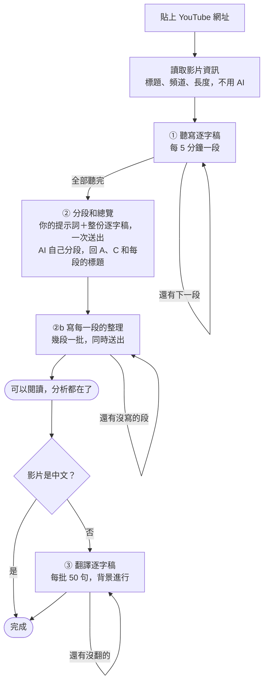

# Reader：影片分析流程與所有 AI 提示詞

這份文件由 `python3 tools/prompts_doc.py` 從程式產生，列出每一次呼叫 AI 的地方和完整提示詞。要改就告訴我「哪一段要怎麼改」。

## 一、流程



| 編號 | 做什麼 | 輸入 | 一支影片呼叫幾次 |
|---|---|---|---|
| ① | 聽寫逐字稿 | 影片本身（5 分鐘片段） | 影片分鐘數 ÷ 5 |
| ② | 分段和總覽：(A) 第一性原理摘要、(C) 推論強弱檢查、(B) 每段從哪裡開始和標題 | 整份逐字稿 | 1 |
| ②b | (B) 每一段的整理全文 | 那幾段的逐字稿，加上 (A) 和全部的分段 | 段數 ÷ 2 左右 |
| ③ | 翻譯成繁體中文（只有非中文影片） | 50 個句子 | 句數 ÷ 50 |

每一步失敗最多重試 3 次。

**為什麼 (B) 分開寫。** 平台限制每次執行 150 秒。一支一小時的影片，三份成果全部寫出來大約一萬個 token，一次寫完會超過時間。所以第一次只讓 AI 讀整份逐字稿、決定怎麼分段、寫 (A) 和 (C)；每段的整理接著分批寫，每批最多 3 段、25 分鐘逐字稿，一次同時送 3 批。分段仍然是 AI 看過整份逐字稿後照你的步驟三決定的，不管影片多長都一樣。某一批一直失敗時，其他段照樣寫好、影片照樣可以讀，那一段之後在背景用「重寫單一段」補上。

## 二、② 分段和總覽

下面第一塊是你 2026-11-23 給的提示詞，程式裡一字不差（`tests/fixtures/owner-prompt.txt` 存了你的原文，測試會逐字比對）。

```text
# 任務
分析下方的逐字稿，產出兩份成果：(A) 第一性原理摘要，(B) 分段整理。最後附上 (C) 推論強弱檢查。

# 寫作規範
- 使用繁體中文，句子要完整、流暢。不要用箭頭、破折號串接的片段或電報式縮寫；靠清楚的結構維持資訊密度，不要靠壓縮。
- 避免 AI 腔：不用「這不是 X，而是 Y」的對仗句，不寫勵志式結尾，不把原文換句話說再倒回來。
- 忠於原文：轉述講者主張時，強度、範圍和條件都要與原文一致，不可放大或縮小。特別注意：
  - 實踐步驟要照原文的起手份量寫。講者說「從一個資料夾開始」，就不能寫成「匯出五年紀錄」。
  - 講者明說的限制、例外與自我警告要保留。
  - 不要寫成講者沒有宣稱過的絕對說法，例如「永遠不會過時」。
- 術語一致：同一個詞在全文只能指同一件事。若講者用兩個相近的詞指不同東西（例如知識庫與資料庫），要分清楚。
- 數字、人名、案例要和逐字稿一致，不可補充原文沒有的資訊。

# 步驟一：先拆解（不輸出，作為內部工作）
1. 找出講者整場論證的最終結論，一句話就要能說完。
2. 往回推：要讓這個結論成立，至少需要哪些不可再化約的前提？只保留真正承擔邏輯負荷的前提，通常是 2 到 4 個。
3. 把前提到結論之間的推論步驟排成一條鏈，檢查每一步都能從上一步推得。如果某個關鍵前提只在標題或口號裡出現、沒有進入推論，就把它放回推論鏈。
4. 區分三種內容：承擔推論的主張、用來佐證的案例或數據、只提供情感或修辭作用的故事與隱喻。
5. 找出講者架構裡最核心的那個「瓶頸」或「關鍵機制」，並確認你對它的理解沒有和原文相反。

# 步驟二：輸出 (A) 第一性原理摘要
格式如下：

**標題**：兩句話。第一句講核心判斷，第二句講這帶來什麼能力或結果。

**第一性原理**：一段完整的散文，4 到 6 句，依序寫出前提、瓶頸、機制、複利或後果，讓讀者讀完就能自己重建整條推論。

接著依講者內容分成 3 到 5 個主題區塊（例如：起點、核心架構、實踐步驟、產權與防禦），每個區塊 2 到 5 個條列。每個條列寫成完整句子，格式為「概念：一句說明」。凡是講者提出的「機制」，都要寫出它怎麼運作，不能只寫名稱。

**核心提醒**：一句可以立即執行的行動。

# 步驟三：輸出 (B) 分段整理
- 依逐字稿的原始段落（含時間戳）逐段整理。若原文沒有分段，就依主題轉折自行分段並標註。
- 每段先寫一兩句說明這段在整體論證中的作用，再整理重點。
- 遇到核心概念時，先給心智模型或類比，再講細節。
- 適合比較的內容（例如講者回應的質疑、兩種對照情境）用表格呈現。
- 引用原文要短，盡量轉述。

# 步驟四：輸出 (C) 推論強弱檢查
針對步驟一的推論鏈，逐環標出：
- 哪幾環邏輯最穩，為什麼。
- 哪幾環藏有未說明的假設。
- 哪些證據來自講者本人或其利益相關機構、只能證明相關性，或無法歸因。
- 講者的主張和他自己的做法或其他段落之間，有沒有矛盾。
直接點出問題，不需要迴避或平衡措辭。

# 最後自我檢查（不輸出）
逐條比對 (A) 和 (B) 的每個條列與逐字稿：是否有誇大、誤讀、遺漏講者的限制條件，或術語前後不一致？發現問題就修正後再輸出。
```

你的原文到「# 逐字稿」之前為止。程式在後面接上這一段，告訴 AI 這一次交哪些、怎麼放進資料庫要的欄位，然後才是逐字稿：

```text
# 輸出
這一次先交 (A)、(C) 和 (B) 的分段。(B) 每一段的整理全文下一步才寫，這一次每段只要開始的秒數和標題，但分段要照步驟三的判斷切好。(A) 的標題放 headline，第一性原理放 principle，主題區塊放 groups（每個區塊的名稱放 title，條列放 points），核心提醒放 reminder。(B) 的每一段是 sections 裡的一項，照時間順序，第一段從逐字稿第一行開始，整份逐字稿都要分到：t 是這一段開始的秒數，title 是這一段的標題。(C) 的四項依序放 check 的 solid、assumptions、evidence、contradictions，每一項都是條列；哪一項沒有內容就給空陣列。
JSON：{"lang":"<逐字稿語言的 BCP-47 代碼，例如 en、zh-TW、ja>","title":"<影片標題，看不出來就寫最貼切的一句>","host":"<訪問者或主持人的 speaker 標籤，沒有就寫空字串>","headline":"<(A) 的標題>","principle":"<(A) 的第一性原理>","groups":[{"title":"<主題區塊的名稱>","points":["<條列>"]}],"reminder":"<(A) 的核心提醒>","check":{"solid":["<邏輯最穩的一環和原因>"],"assumptions":["<未說明的假設>"],"evidence":["<證據的問題>"],"contradictions":["<矛盾>"]},"sections":[{"t":<這一段開始的秒數，必須是逐字稿裡某一行開頭方括號裡的數字>,"title":"<你為這一段標註的標題>"}]}

# 逐字稿
每一行開頭的方括號是那一行開始的秒數，這就是時間戳。
<transcript>
{[秒數] 講者: 內容，一行一段}
</transcript>
```

分幾段、切在哪、每段叫什麼，都由 AI 依你的步驟三決定。程式沒有另外給分段或標題的規則。

欄位對應到畫面：

| 欄位 | 畫面上的位置 |
|---|---|
| headline | 總覽最上面的大字 |
| principle | 總覽「第一性原理」 |
| groups | 總覽的各個主題區塊 |
| reminder | 總覽「核心提醒」 |
| check | 總覽「推論強弱檢查」的四類 |
| sections[].title | 章節標題 |
| sections[].body | 每段的整理全文（下一步 ②b 寫）。顯示在總覽的「分段整理」和閱讀頁每段逐字稿下面 |

### ②b 每一段的整理

用的是你原文裡的寫作規範、步驟三和最後自我檢查，一字不改，加上已經寫好的 (A) 標題和第一性原理、整支影片的分段清單，和這一批那幾段的逐字稿：

```text
# 任務
分析下方的逐字稿，產出 (B) 分段整理。整支影片已經依主題轉折分好段，(A) 第一性原理摘要也寫好了，都附在下面，讓你知道整體論證。這一次只寫指定的 {段數} 段，分段和標題照給定的，不要改。

{你的「# 寫作規範」}

{你的「# 步驟三」}

{你的「# 最後自我檢查」}

# 輸出
每一段是 sections 裡的一項，t 照抄給定的秒數，這一段的整理全文放 body，是一段文字，照步驟三的寫法自由安排：段落之間空一行，條列每行用「- 」開頭，有先後的步驟用「1. 」編號，要強調的引導詞用 **粗體**，表格用 | 欄 | 欄 | 的寫法（第一列是欄名）。
JSON：{"sections":[{"t":<這一段給定的秒數>,"body":"<這一段的整理全文>"}]}

# 整支影片的 (A) 第一性原理摘要
{headline}
{principle}

# 整支影片的分段
1. [秒數] 標題
…

# 這一次要寫的逐字稿
每一行開頭的方括號是那一行開始的秒數，這就是時間戳。
<transcript>
## 第 N 段（t = 秒數）：標題
{[秒數] 講者: 內容，一行一段}
</transcript>
```

### 誰寫

Supabase 有設 `ANTHROPIC_API_KEY` 時，② 和 ②b（還有翻譯）由 Claude 寫，模型預設 `claude-sonnet-5-5`，可以用 `CLAUDE_MODEL` 換。沒有設就由 Gemini 寫。聽寫 ① 一律是 Gemini，因為只有它能直接看 YouTube 影片。

## 三、① 聽寫逐字稿

```text
Transcribe the speech in this video clip verbatim, in the language spoken. The clip is the part of the video from {開始} to {結束}.
Return JSON only: {"turns":[{"ts":"MM:SS","speaker":"name","text":"..."}],"visuals":[{"ts":"MM:SS","text":"..."}],"reached_end":true|false}
- "ts" is the timestamp in the FULL video (not relative to the clip) where the turn starts, as MM:SS, or H:MM:SS past one hour.
- Start a new turn at every speaker change and at least every 30 seconds.
- Transcribe everything that is said from the first second of the clip to the last. Do not skip, shorten, summarise or translate.
- "speaker": the person's real name if it is said or shown; otherwise "Speaker 1", "Speaker 2".
- "visuals": text or figures on slides, whiteboards, code or screen recordings that carry information the speech does not say aloud. Empty array if none.
- If a stretch has no speech but shows something (slides, a demo, a scene), add a turn with speaker "On screen" whose text quotes any visible text exactly and then says in one plain sentence what happens.
- "reached_end" is true only if the video itself finishes before {結束}.
```

## 四、③ 翻譯

```text
把下面 {句數} 個句子翻成繁體中文（台灣用語）。它們是同一段訪談或演講裡連續的句子。
輸出 JSON：{"zh":["<第 1 句的翻譯>", ...]}，陣列長度必須剛好是 {句數}，順序一一對應。
規則：
- 忠於原意，不要加原文沒有的內容，不要省略。
- 翻成台灣人講話的樣子，像好的字幕。原文是口語就翻口語，短句就翻短句。
- 不要書面連接詞（透過、藉由、進而、然而、此外），不要把動詞翻成名詞（「進行了討論」寫成「聊了」）。
- 產品名、人名、技術名詞保留原文。「you know」「I mean」這類贅字可以順掉。

這一章的主題：{分段標題}

1. {句子}
…
```

## 五、不在自動流程裡的

- **重寫單一段**：某一段的整理失敗或你想重寫時，閱讀頁會出現「整理這一段」。它送出你的寫作規範、步驟三和最後自我檢查，加上那一段的逐字稿，回來的一樣是那一段的整理全文。
- **請 AI 解釋這句**（點句子後的面板）：只在 Claude 預覽頁有作用，部署版沒有接上。
