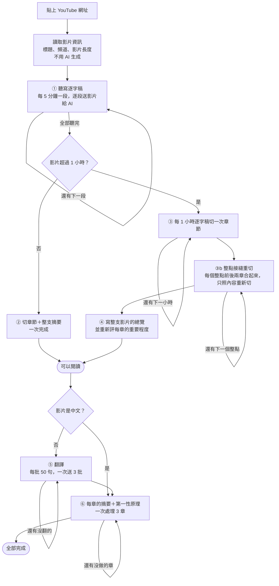

# Reader：影片分析流程與所有 AI 提示詞

這份文件列出目前每一次呼叫 AI 的地方和完整提示詞。要改的話，直接在這份文件上改，或告訴我「第幾號提示詞要怎麼改」。

- 模型：`gemini-3.8-flash`（讀影片和文字階段都是）
- 程式位置：`supabase/functions/ingest/pipeline.js`
- `{大括號}` 是程式會填進去的變數

## 一、流程圖



每一步失敗最多重試 3 次。①到④失敗 3 次，影片標成失敗；⑤⑥失敗 3 次只停掉背景工作，影片仍可閱讀。

| 編號 | 做什麼 | 輸入 | 一支影片呼叫幾次 |
|---|---|---|---|
| ① | 聽寫逐字稿 | 影片本身（5 分鐘片段） | 影片分鐘數 ÷ 5 |
| ② | 切章節＋整支摘要（1 小時內的影片） | 完整逐字稿 | 1 |
| ③ | 切章節（超過 1 小時的影片） | 1 小時的逐字稿 | 影片小時數 |
| ③b | 整點接縫重切（超過 1 小時的影片） | 整點前後兩章的逐字稿 | 影片小時數 − 1 |
| ④ | 整支總覽（超過 1 小時的影片） | 章節清單＋開頭逐字稿 | 1 |
| ⑤ | 翻譯成繁體中文 | 50 個句子 | 句數 ÷ 50 |
| ⑥ | 每章摘要＋第一性原理 | 一章的逐字稿 | 章數 |

另外有三個「使用者按了才跑」的提示詞（⑦⑧⑨），列在最後。

## 二、共用的寫法規則

②③④⑥ 都會附上這一段「怎麼寫」。改這裡會同時影響章節標題、摘要、第一性原理。

### 寫法規則（STYLE）

```text
怎麼寫（這一段最重要，寫完請逐句對照）：
- 像你看完影片後講給朋友聽。用台灣人平常講話的字。短句，一句只講一件事。一句裡的逗號超過兩個就拆成兩句。
- 不要想用一句話把所有重點講完。寧可只講最重要的一件，講清楚。
- 先講具體的事：誰、做了什麼、數字多少。道理放後面，而且用講者自己的例子講。
- 用動詞講，不要把動作變成名詞。寫「他兩週就上線」，不要寫「進行快速的產品驗證」。
- 這些詞不要用：透過、藉由、進而、從而、打造、賦能、極致、極簡、核心、關鍵、本質、痛點、心法、迷思、哲學、思維、底層邏輯、最大化、優化、落地、聚焦、洞察、驅動、建構、形塑、彰顯。
- 少用「度、性、化」結尾的抽象名詞（自由度、可能性、最佳化）。「自動化」這種本來就是日常用詞的可以。
- 不要四個字四個字地排，不要成語連發。不要用「並」「且」「並且」把好幾件事串成一句，也不要一次並列三樣東西。
- 口語，但不要網路用語和火星文（免費仔、寫扣、鎂、神器、狂、超扯）。
- 不要「不是 X，而是 Y」，不要勵志口吻，不要破折號，不要 emoji，不要在句尾補一句總結。除了本來就要你提問的欄位，不要用問句。
- 產品名、人名、技術名詞保留原文。只能寫內容裡有的事實，不可以編數字或主張。
```

### 章節用的好壞對照（EX_CHAPTER）— 用在 ②③④

```text
寫法對照：
標題　好：「先收錢，再相信」「鏟沙」「不想當 CEO」「一個月的牆」「兩分鐘修好」
　　　不好：「極簡創業與付費驗證」「潛意識醞釀與極簡記錄」（兩個抽象名詞用「與」並列，沒有畫面）
sum　 好：「他不拿創投，設計、程式、logo 全部自己來。點子兩週內上線，有人刷卡才算數。」
　　　不好：「分享不拿創投的獨立開發模式，將點子做成微型產品並在兩週內上線，直接用用戶刷卡付款驗證需求。」
take　好：「卡住的時候，給自己一個每月要上線一次的期限。」
　　　不好：「陷入停滯時設定固定週期的上線挑戰，用強制發布逼迫自己持續產出。」
thesis 好：「Pieter Levels 一個人做了 70 幾個產品，賺錢的只有 4 個。他不募資，想到就做，兩週內上線，有人刷卡才繼續。」
　　　不好：「一個人不募資，靠很多次兩週就上線的小實驗，找出有人願意付錢的那一個，再用自動化讓它不必變成一家公司。」（一個長句塞四件事，沒有人、沒有數字，像機器寫的摘要）
　　　不好：「一人創業者應捨棄募資與複雜架構，透過市場付費訊號快速驗證點子。」
　　　不好：「他主張人必須相信當下的直覺，做自己真心熱愛的事，並用死亡的必然性甩開旁人的眼光。」（並列三件事，還有「必然性」這種抽象名詞）
　　　改成：「他每天早上照鏡子問自己：如果今天是最後一天，我還想做今天要做的事嗎？」
tldr　好：「怎麼知道點子行不行：看有沒有陌生人付錢。註冊、按讚都不算。」
　　　不好：「打造微型產品並在兩週內串接 Stripe 收費，以信用卡實際付款作為驗證需求的唯一標準。」
```

### 第一性原理用的好壞對照（EX_ANALYSIS）— 用在 ⑥

```text
寫法對照：
title　好：「先收錢，再相信」「鏟沙」「不想當 CEO」　不好：「被蘋果開除後歸零」「連續轉型與純手動驗證」
spark　好：「有人掏信用卡，才算驗證」「難的是決定不做什麼」
sum　　好：「判斷標準是有人付錢。註冊和稱讚都不算。」
　　　 不好：「意識到自己依然熱愛這份工作，於是卸下成功包袱創辦了 NeXT 與 Pixar。」
core　 好：「動機是行動的副產品。等有動機才行動，順序反了。」
　　　 好：「流程存在的理由是降低出錯的代價。出錯的代價本來就低的時候，流程只剩下成本。」
　　　 不好：「失去既有成功的沉重包袱，能讓人重獲初學者的自由度去探索高創造力的全新嘗試。」
chain　好：「沒有人能事先知道哪個點子會成。他自己也說多數失敗。」
　　　 好：「註冊和稱讚不花對方任何成本，所以幾乎不帶資訊。付錢要花成本，所以是誠實的訊號。」
　　　 不好：「維持既有成功需要承擔維護現狀的沉重負擔，限制了冒險空間。」
ask　　好：「你手上哪個點子，其實兩週內就能放上一個付款按鈕？你一直沒放，是在保護什麼？」
　　　 不好：「你現在緊抓不放的既有想法或微小成果，是否正阻礙你像初學者一樣靈活探索新方向？」
counter 好：「壞了再修只在錯誤可逆時成立。金流算錯、資料外洩，兩分鐘修不回來。你的產品裡哪些地方不可逆？」
```

### 讀者設定 — 用在 ②③④⑥

```text
一位正在找 product-market fit 的一人創業者
```

## 三、各階段提示詞

### ① 聽寫逐字稿

送出的內容：影片的一個 5 分鐘片段 ＋ 下面這段文字。溫度設為 0（盡量照實聽寫）。

```text
Transcribe the speech in this video clip verbatim, in the language spoken. The clip is the part of the video from {片段開始時間} to {片段結束時間}.
Return JSON only: {"turns":[{"ts":"MM:SS","speaker":"name","text":"..."}],"visuals":[{"ts":"MM:SS","text":"..."}],"reached_end":true|false}
- "ts" is the timestamp in the FULL video (not relative to the clip) where the turn starts, as MM:SS, or H:MM:SS past one hour.
- Start a new turn at every speaker change and at least every 30 seconds.
- Transcribe everything that is said from the first second of the clip to the last. Do not skip, shorten, summarise or translate.
- "speaker": the person's real name if it is said or shown; otherwise "Speaker 1", "Speaker 2". Speakers already identified earlier in this video: {前面已出現的講者名字}. Reuse these exact labels for the same people.
- "visuals": text or figures on slides, whiteboards, code or screen recordings that carry information the speech does not say aloud. Empty array if none.
- If a stretch has no speech but shows something (slides, a demo, a scene), add a turn with speaker "On screen" whose text quotes any visible text exactly and then says in one plain sentence what happens.
- "reached_end" is true only if the video itself finishes before {片段結束時間}. Reaching the end of this clip is not the end of the video. If the clip lies entirely after the end of the video, return empty arrays and reached_end true.
```

### 章節的欄位定義 — 用在 ②③

每一章 AI 要填這些欄位：

```text
{"t":<這一章開始的秒數，必須是逐字稿裡某一行的秒數>,
 "en":"<原文語言的短標題>",
 "zh":"<10 字內的中文標題，像人會講的一句話，有畫面>",
 "sum":"<兩三個短句，75 字內，講者實際說了或做了什麼，帶具體的數字、名稱、做法>",
 "take":"<一句 40 字內可帶走的原則；純閒聊、或內容本身沒有可帶走的道理就留空字串，不要硬湊>",
 "worth":<1 到 3 的整數，3 是核心>}
```

章節的切法規則：

```text
- 依主題切章，一章只講一件事。20 分鐘以內的影片切 3 到 6 章；更長的影片每章大約 3 到 15 分鐘，任何一章都不要超過 15 分鐘，話題換了就切。
- worth 看的是「這一章對讀者有多少可以帶走的東西」：3 是核心論點或可以直接照做的方法，2 是有用的補充，1 是開場、閒聊、致謝這類可以跳過的。3 分最多佔三分之一。
- 講者是 "On screen" 的段落是畫面描述，照樣整理進章節。

{寫法規則 STYLE}

{章節用的好壞對照 EX_CHAPTER}
```

### 整支影片的欄位定義 — 用在 ②④

```text
"lang":"<逐字稿語言的 BCP-47 代碼，例如 en、zh-TW、ja>",
"title":"<影片標題，看不出來就寫最貼切的一句>",
"host":"<訪問者或主持人的 speaker 標籤，沒有就寫空字串>",
"thesis":"<兩到三個短句，70 字內。第一句講這個人是誰、做了什麼讓人想聽他講，要有具體的數字或事實。後面只講他最主要的「一個」做法或主張，用他自己的例子講，不要並列好幾個>",
"tldr":["<重點 1，一到兩個短句>","<重點 2>","<重點 3>"]
```

`thesis` 就是總覽頁最上面那段話，`tldr` 是下面的三個重點。

### ② 切章節＋整支摘要（1 小時內的影片）

```text
下面是一支影片的完整逐字稿，每一行開頭的方括號是該段開始的秒數。請幫{讀者設定}整理這支影片，讓他能很快判斷值不值得細看。

輸出 JSON：
{{整支影片的欄位定義},"chapters":[{章節的欄位定義}]}

規則：
- 第一章從第一行的秒數開始。整支影片最重要的那一章一定要是 3。
{章節的切法規則}

逐字稿：
{[秒數] 講者: 內容，一行一段}

畫面上出現、講者沒有唸出來的文字：
{[秒數] 文字}
```

### ③ 切章節（超過 1 小時的影片，每小時一次）

```text
下面是一支長影片逐字稿的第 {N} 部分（共 {總數} 部分），每一行開頭的方括號是該段開始的秒數。請幫{讀者設定}把這一部分切成章節。

輸出 JSON：{"chapters":[{章節的欄位定義}]}

規則：
- 只整理這一部分的內容。第一章從這一部分第一行的秒數開始。
{章節的切法規則}

逐字稿：
{這一小時的逐字稿}

畫面上出現、講者沒有唸出來的文字：
{[秒數] 文字}
```

### ③b 整點接縫重切（超過 1 小時的影片，每個整點一次）

③ 是每一小時切一次，所以每個整點一定會有一刀。這一步把整點前、後兩章的逐字稿合起來，請 AI 只照內容重切：同一個話題就合成一章，話題真的換了就切在真正換的那一行。

```text
下面是一支長影片裡連續的一段逐字稿，每一行開頭的方括號是該段開始的秒數。這一段原本在 [{整點的秒數}] 被切成兩章，但那一刀只是因為影片太長、要分批處理才切的，不代表話題在那裡換了。請幫{讀者設定}只看內容，把這一段重新切成章節。

輸出 JSON：{"chapters":[{章節的欄位定義}]}

規則：
- 第一章從這一段第一行的秒數開始。
- 如果整段都在講同一件事，就只給一章。如果話題確實換了，切在話題真正換的那一行，不一定是 [{整點的秒數}]。
{章節的切法規則}

逐字稿：
{整點前後兩章的逐字稿}
```

### ④ 整支影片的總覽（超過 1 小時的影片）

```text
下面是一支長影片的章節清單（已經整理好），以及影片開頭的一小段逐字稿。請幫{讀者設定}寫出整支影片的總覽。

輸出 JSON：{{整支影片的欄位定義},"worth":[<依章節順序，每一章 1 到 3 的整數>]}

規則：
- thesis 和 tldr 要從整支影片挑最重要的講，不要只看開頭，也不要每一章都點到。
- worth 是把所有章節放在一起重新評：3 是整支影片的核心，最多佔三分之一；1 是可以跳過的。陣列長度必須是 {章數}。

{寫法規則 STYLE}

{章節用的好壞對照 EX_CHAPTER}

章節：
{編號. [時間] 中文標題（原文標題）：摘要 → 可帶走的原則}

開頭逐字稿：
{前 12 段，最多 3000 字}
```

### ⑤ 翻譯

```text
把下面 {句數} 個句子翻成繁體中文（台灣用語）。它們是同一段訪談或演講裡連續的句子。
輸出 JSON：{"zh":["<第 1 句的翻譯>", ...]}，陣列長度必須剛好是 {句數}，順序一一對應。
規則：
- 忠於原意，不要加原文沒有的內容，不要省略。
- 翻成台灣人講話的樣子，像好的字幕。原文是口語就翻口語，短句就翻短句。
- 不要書面連接詞（透過、藉由、進而、然而、此外），不要把動詞翻成名詞（「進行了討論」寫成「聊了」）。
- 產品名、人名、技術名詞保留原文。「you know」「I mean」這類贅字可以順掉。

這一章的主題：{章節標題}

1. {句子}
2. {句子}
…
```

### ⑥ 每章的摘要＋第一性原理

```text
下面是影片其中一章的逐字稿，每句前面有編號。請幫一位正在找 product-market fit 的一人創業者讀懂它。

輸出 JSON：
{"title":"<8 字內的中文標題，具體、有畫面>",
 "spark":"<14 字內，這一章最值得記住的一句話>",
 "sum":["<這段在說什麼 1>","<2>","<3>"],
 "core":"<第一性原理：這個做法為什麼成立的最根本理由。一到兩個短句>",
 "chain":["<推理第 1 步：最基本的前提>","<第 2 步>","<第 3 步>","<第 4 步：結論>"],
 "ask":"<一個把這個原理換到讀者自己身上的問題>",
 "key":[<最能代表這一章的 1 到 2 個句子編號，要相鄰>],
 "counter":"<站在反方，指出這個結論最弱的一個環節或不適用的情況，用一個問題結尾，100 字內>"}

規則：
- core 和 chain 要從前提一步步推到結論，每一步都能獨立成立，不要只是換句話重複摘要。
- 照內容本身的道理寫。如果這一章跟創業或做產品無關（例如故事、動畫、純示範），就講它本身的道理，ask 也問一般性的問題，不要硬套到創業上。
- ask 和 counter 本來就要用問句，其他欄位不要。

{寫法規則 STYLE}

{第一性原理用的好壞對照 EX_ANALYSIS}

這一章的主題：{章節標題}

{編號. 講者: 句子}
```

欄位對應到畫面：

| 欄位 | 畫面上的位置 |
|---|---|
| title | 精讀後的章節標題 |
| spark | 淬煉頁「AI 挑的」那張卡 |
| sum | 「這一段在說什麼」 |
| core | 「第一性原理」 |
| chain | 「展開推理鏈」 |
| ask | 「換到你身上」 |
| key | 這一章被標成重點的句子 |
| counter | 淬煉頁的反方提問 |

## 四、使用者按了才跑的提示詞

這三個在 `src/app.html`，只在 Claude 預覽頁（artifact）裡有作用，部署版目前沒有接上。

### ⑦ 請 AI 解釋這句（點句子後的面板）

```text
你是陪讀夥伴。讀者的母語是繁體中文，是一位創業者，正在讀一段英文訪談逐字稿。請用繁體中文、最多 90 個字，解釋下面這句話在上下文中的意思，並點出它背後的一個假設。直接講，不要開場白，不要條列。

這段的主題：{章節標題}
上下文：{同一段發言的所有句子}
要解釋的句子：{句子原文}
```

### ⑧ 反方挑戰（淬煉頁，針對你寫的主張）

```text
你是嚴格但友善的辯論對手。讀者看完一段訪談，用自己的話寫下一個主張。請用繁體中文、最多 100 個字，指出這個主張最弱的一個環節（一個具體反例，或一個沒說出口的假設），最後用一個問題結尾。不要稱讚，不要重述他的話，不要條列。

訪談重點：{這一章的 sum}
他引用的證據：{他選的畫線句子}
讀者的主張：{他寫的主張}
```

### ⑨ 整理成貼文（觀點卡頁）

```text
把下面這位讀者自己寫的結論整理成一篇繁體中文社群貼文，250 字以內。規則：只能使用他寫的觀點，不能加入新論點；保留他的口吻；不要勵志結尾，不要 hashtag，不要 emoji。

{他寫的結論}
```
