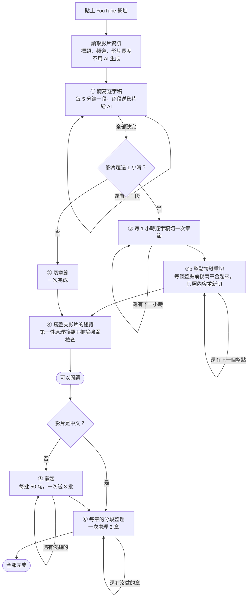

# Reader：影片分析流程與所有 AI 提示詞

這份文件列出目前每一次呼叫 AI 的地方和完整提示詞。要改的話，直接在這份文件上改，或告訴我「第幾號提示詞要怎麼改」。

- 模型：`gemini-3.8-flash`（讀影片和文字階段都是）
- 程式位置：`supabase/functions/ingest/pipeline.js`
- `{大括號}` 是程式會填進去的變數

## 一、流程圖



每一步失敗最多重試 3 次。①到④失敗 3 次，影片標成失敗；⑤⑥失敗 3 次只停掉背景工作，影片仍可閱讀。

| 編號 | 做什麼 | 輸入 | 一支影片呼叫幾次 |
|---|---|---|---|
| ① | 聽寫逐字稿 | 影片本身（5 分鐘片段） | 影片分鐘數 ÷ 5 |
| ② | 切章節（1 小時內的影片） | 完整逐字稿 | 1 |
| ③ | 切章節（超過 1 小時的影片） | 1 小時的逐字稿 | 影片小時數 |
| ③b | 整點接縫重切（超過 1 小時的影片） | 整點前後兩章的逐字稿 | 影片小時數 − 1 |
| ④ | 整支總覽：(A) 第一性原理摘要＋(C) 推論強弱檢查 | 章節清單＋完整逐字稿 | 1 |
| ⑤ | 翻譯成繁體中文 | 50 個句子 | 句數 ÷ 50 |
| ⑥ | 每章的 (B) 分段整理 | 一章的逐字稿＋整支的標題和第一性原理 | 章數 |

另外有三個「使用者按了才跑」的提示詞（⑦⑧⑨），列在最後。

## 二、共用的寫法規則

這裡有兩套規則。

**總覽和每章的分段整理（④⑥）用的是你 2026-11-23 給的那份提示詞。** 它本來是一份一次做完 A、B、C 的提示詞；因為影片很長、每章要分開處理，程式把它拆成幾塊，分別送給 ④ 和 ⑥，字句照你的原文：

| 你的段落 | 程式裡的名字 | 用在 |
|---|---|---|
| 寫作規範 | RULES | ④⑥ |
| 步驟一：先拆解 | DECOMPOSE | ④ |
| 步驟二：(A) 第一性原理摘要 | BRIEF | ④ |
| 步驟三：(B) 分段整理 | SECTION | ⑥ |
| 步驟四：(C) 推論強弱檢查 | CHECK_SPEC | ④ |
| 最後自我檢查 | SELF_CHECK | ④⑥ |

這六段在程式裡跟你的原文一字不差（有測試逐字比對，`tests/fixtures/owner-prompt.txt` 是你的原文）。哪個標題要存進哪個欄位，寫在每次呼叫最後的「# 輸出」那一段，不放進你的文字裡。

**切章節（②③③b）仍用原本的規則**：寫法規則 STYLE、標題怎麼下 TITLES、章節用的好壞對照。

### 寫作規範（RULES）— 用在 ④⑥

```text
# 寫作規範
- 使用繁體中文，句子要完整、流暢。不要用箭頭、破折號串接的片段或電報式縮寫；靠清楚的結構維持資訊密度，不要靠壓縮。
- 避免 AI 腔：不用「這不是 X，而是 Y」的對仗句，不寫勵志式結尾，不把原文換句話說再倒回來。
- 忠於原文：轉述講者主張時，強度、範圍和條件都要與原文一致，不可放大或縮小。特別注意：
  - 實踐步驟要照原文的起手份量寫。講者說「從一個資料夾開始」，就不能寫成「匯出五年紀錄」。
  - 講者明說的限制、例外與自我警告要保留。
  - 不要寫成講者沒有宣稱過的絕對說法，例如「永遠不會過時」。
- 術語一致：同一個詞在全文只能指同一件事。若講者用兩個相近的詞指不同東西（例如知識庫與資料庫），要分清楚。
- 數字、人名、案例要和逐字稿一致，不可補充原文沒有的資訊。
```

### 最後自我檢查（SELF_CHECK）— 用在 ④⑥

```text
# 最後自我檢查（不輸出）
逐條比對 (A) 和 (B) 的每個條列與逐字稿：是否有誇大、誤讀、遺漏講者的限制條件，或術語前後不一致？發現問題就修正後再輸出。
```

### 寫法規則（STYLE）— 用在 ②③③b

```text
寫法規則：
- 不要「不是 X，而是 Y」，不要勵志口吻，不要破折號，不要 emoji，不要在句尾補一句總結。除了本來就要你提問的欄位，不要用問句。
- 產品名、人名、技術名詞保留原文。只能寫內容裡有的事實，不可以編數字或主張。
```

### 章節用的好壞對照（EX_CHAPTER）— 用在 ②③③b

```text
寫法對照（標題以外的欄位）：
sum　 好：「他不拿創投，設計、程式、logo 全部自己來。點子兩週內上線，有人刷卡才算數。」
　　　不好：「分享不拿創投的獨立開發模式，將點子做成微型產品並在兩週內上線，直接用用戶刷卡付款驗證需求。」
```

### 標題怎麼下（TITLES）— 用在 ②③③b

這是你提供的標題規則，原文放入。

```text
標題怎麼下（zh 欄位）：
標題要能當結論筆記用：讀者只看所有標題，就能知道這一章在講什麼。

格式：「概念：具體例子」，兩個半句都要有。

前半句：概念
1. 寫出這段的結論或核心觀念，6 到 10 字。
2. 寫答案，不要只寫問題。「經濟學在問什麼」只丟出問題，讀者還是不知道答案；「經濟學的三個層次」直接把答案框出來。
3. 用講者實際使用的概念名稱，像稀少性、機會成本、沉沒成本，方便讀者之後查找。
4. 不要繞口或文字遊戲，例如「看似不理性的理性」。

後半句：例子
1. 選最能代表整段論點的例子，5 到 10 字。不要挑段尾順帶一提的小例子。
2. 例子要具體、有畫面，讓讀者一看就想起內容。
3. 如果這段的重點是框架或分類，例子不足以代表整段，後半句可以改寫框架本身，例如「個人、互動、整體」。

自我檢查：寫完每個標題後問自己兩件事。任一題答案是否定的，就重寫。
- 沒聽過這堂課的人，只看標題能不能說出這段的結論？
- 例子是不是這段花最多篇幅、最能撐起論點的那個？

好與壞的例子：
- 壞：經濟學在問什麼：教室擠了老師高興
  好：經濟學的三個層次：個人、互動、整體
  原因：前半句只有問題沒有答案，例子也只對應三個層次中的一個。
- 壞：人們面臨取捨：印鈔機也有成本
  好：人們面臨取捨：接六個家教就沒空念書
  原因：印鈔機是段尾的小例子，這段主要在講個人時間的取捨。
- 壞：誘因藏在意想不到處：不戴套的價差
  好：補償夠高就願意冒險：不戴套的價差
  原因：前半句沒說出誘因怎麼運作。
- 好：稀少性與選擇：賣牛丼還是咖哩飯
- 好：理性與最適化：考第九名剛剛好
- 好：為什麼要忽略沉沒成本：沉下去的一千塊

標題的語氣：
- 用口語、直白的說法。
- 不用驚嘆號、引號，也不用「揭秘」「真相」「你不知道的」這類標題黨字眼。
- 同一份逐字稿的例子半句之間，不要重複句型。
```

### 讀者設定 — 用在 ②③③b（④⑥ 照你的新提示詞，沒有讀者設定）

```text
一位正在找 product-market fit 的一人創業者
```

## 三、各階段提示詞

### ① 聽寫逐字稿

送出的內容：影片的一個 5 分鐘片段 ＋ 下面這段文字。溫度設為 0（盡量照實聽寫）。

```text
Transcribe the speech in this video clip verbatim, in the language spoken. The clip is the part of the video from {片段開始時間} to {片段結束時間}.
Return JSON only: {"turns":[{"ts":"MM:SS","speaker":"name","text":"..."}],"visuals":[{"ts":"MM:SS","text":"..."}],"reached_end":true|false}
- "ts" is the timestamp in the FULL video (not relative to the clip) where the turn starts, as MM:SS, or H:MM:SS past one hour.
- Start a new turn at every speaker change and at least every 30 seconds.
- Transcribe everything that is said from the first second of the clip to the last. Do not skip, shorten, summarise or translate.
- "speaker": the person's real name if it is said or shown; otherwise "Speaker 1", "Speaker 2". Speakers already identified earlier in this video: {前面已出現的講者名字}. Reuse these exact labels for the same people.
- "visuals": text or figures on slides, whiteboards, code or screen recordings that carry information the speech does not say aloud. Empty array if none.
- If a stretch has no speech but shows something (slides, a demo, a scene), add a turn with speaker "On screen" whose text quotes any visible text exactly and then says in one plain sentence what happens.
- "reached_end" is true only if the video itself finishes before {片段結束時間}. Reaching the end of this clip is not the end of the video. If the clip lies entirely after the end of the video, return empty arrays and reached_end true.
```

### 章節的欄位定義 — 用在 ②③

每一章 AI 要填這些欄位：

```text
{"t":<這一章開始的秒數，必須是逐字稿裡某一行的秒數>,
 "en":"<原文語言的短標題>",
 "zh":"<中文標題，格式是「概念：具體例子」，照下面「標題怎麼下」的規則寫>",
 "sum":"<兩三個短句，75 字內，講者實際說了或做了什麼，帶具體的數字、名稱、做法>",
 "worth":<1 到 3 的整數，3 是核心>}
```

章節的切法規則：

```text
- 依講者的論點切換來分段，不要依時間平均切。
- 一段只講一個主要論點，通常是 3 到 10 分鐘的內容。任何一章都不要超過 15 分鐘。
- 講者舉例、離題或回答問題時，如果還在支撐同一個論點，就歸在同一段。
- worth 看的是「這一章對讀者有多少可以帶走的東西」：3 是核心論點或可以直接照做的方法，2 是有用的補充，1 是開場、閒聊、致謝這類可以跳過的。3 分最多佔三分之一。
- 講者是 "On screen" 的段落是畫面描述，照樣整理進章節。

{標題怎麼下 TITLES}

{寫法規則 STYLE}

{章節用的好壞對照 EX_CHAPTER}
```

### ② 切章節（1 小時內的影片）

```text
下面是一支影片的完整逐字稿，每一行開頭的方括號是該段開始的秒數。請幫{讀者設定}把它切成章節。

輸出 JSON：{"chapters":[{章節的欄位定義}]}

規則：
- 第一章從第一行的秒數開始。
{章節的切法規則}

逐字稿：
{[秒數] 講者: 內容，一行一段}

畫面上出現、講者沒有唸出來的文字：
{[秒數] 文字}
```

### ③ 切章節（超過 1 小時的影片，每小時一次）

```text
下面是一支長影片逐字稿的第 {N} 部分（共 {總數} 部分），每一行開頭的方括號是該段開始的秒數。請幫{讀者設定}把這一部分切成章節。

輸出 JSON：{"chapters":[{章節的欄位定義}]}

規則：
- 只整理這一部分的內容。第一章從這一部分第一行的秒數開始。
{章節的切法規則}

逐字稿：
{這一小時的逐字稿}

畫面上出現、講者沒有唸出來的文字：
{[秒數] 文字}
```

### ③b 整點接縫重切（超過 1 小時的影片，每個整點一次）

③ 是每一小時切一次，所以每個整點一定會有一刀。這一步把整點前、後兩章的逐字稿合起來，請 AI 只照內容重切：同一個話題就合成一章，話題真的換了就切在真正換的那一行。

```text
下面是一支長影片裡連續的一段逐字稿，每一行開頭的方括號是該段開始的秒數。這一段原本在 [{整點的秒數}] 被切成兩章，但那一刀只是因為影片太長、要分批處理才切的，不代表話題在那裡換了。請幫{讀者設定}只看內容，把這一段重新切成章節。

輸出 JSON：{"chapters":[{章節的欄位定義}]}

規則：
- 第一章從這一段第一行的秒數開始。
- 如果整段都在講同一件事，就只給一章。如果話題確實換了，切在話題真正換的那一行，不一定是 [{整點的秒數}]。
{章節的切法規則}

逐字稿：
{整點前後兩章的逐字稿}
```

### ④ 整支影片的總覽：(A) 第一性原理摘要＋(C) 推論強弱檢查

每支影片都跑一次，不分長短。

```text
# 任務
分析下方的逐字稿，產出兩份成果：(A) 第一性原理摘要，(C) 推論強弱檢查。（(B) 分段整理會逐段另外處理，這一次不用寫。）用 JSON 輸出。

{寫作規範 RULES}

# 步驟一：先拆解（不輸出，作為內部工作）
1. 找出講者整場論證的最終結論，一句話就要能說完。
2. 往回推：要讓這個結論成立，至少需要哪些不可再化約的前提？只保留真正承擔邏輯負荷的前提，通常是 2 到 4 個。
3. 把前提到結論之間的推論步驟排成一條鏈，檢查每一步都能從上一步推得。如果某個關鍵前提只在標題或口號裡出現、沒有進入推論，就把它放回推論鏈。
4. 區分三種內容：承擔推論的主張、用來佐證的案例或數據、只提供情感或修辭作用的故事與隱喻。
5. 找出講者架構裡最核心的那個「瓶頸」或「關鍵機制」，並確認你對它的理解沒有和原文相反。

# 步驟二：輸出 (A) 第一性原理摘要
格式如下：

**標題**：兩句話。第一句講核心判斷，第二句講這帶來什麼能力或結果。

**第一性原理**：一段完整的散文，4 到 6 句，依序寫出前提、瓶頸、機制、複利或後果，讓讀者讀完就能自己重建整條推論。

接著依講者內容分成 3 到 5 個主題區塊（例如：起點、核心架構、實踐步驟、產權與防禦），每個區塊 2 到 5 個條列。每個條列寫成完整句子，格式為「概念：一句說明」。凡是講者提出的「機制」，都要寫出它怎麼運作，不能只寫名稱。

**核心提醒**：一句可以立即執行的行動。

# 步驟四：輸出 (C) 推論強弱檢查
針對步驟一的推論鏈，逐環標出：
- 哪幾環邏輯最穩，為什麼。
- 哪幾環藏有未說明的假設。
- 哪些證據來自講者本人或其利益相關機構、只能證明相關性，或無法歸因。
- 講者的主張和他自己的做法或其他段落之間，有沒有矛盾。
直接點出問題，不需要迴避或平衡措辭。

{最後自我檢查 SELF_CHECK}

# 輸出
把 (A) 和 (C) 放進下面這個 JSON。(A) 的標題放 headline，第一性原理放 principle，主題區塊放 groups（每個區塊的名稱放 title，條列放 points），核心提醒放 reminder。(C) 的四項依序放 check 的 solid、assumptions、evidence、contradictions，每一項都是條列；哪一項沒有內容就給空陣列。
JSON：{"lang":"<逐字稿語言的 BCP-47 代碼>","title":"<影片標題>","host":"<訪問者或主持人的 speaker 標籤，沒有就寫空字串>",
"headline":"<標題，兩句話>","principle":"<第一性原理，一段 4 到 6 句的散文>",
"groups":[{"title":"<主題區塊的名稱>","points":["<概念：一句說明>"]}],"reminder":"<核心提醒>",
"check":{"solid":["<最穩的一環和原因>"],"assumptions":["<未說明的假設>"],"evidence":["<證據的問題>"],"contradictions":["<矛盾>"]}}

# 章節
這支影片已經切好的章節，讓你知道內容的範圍。摘要和檢查要以逐字稿為準，要看完整份再寫。
{編號. [時間] 中文標題：摘要}

# 逐字稿
<transcript>
{完整逐字稿}
</transcript>
```

欄位對應到畫面（總覽頁，由上到下）：

| 欄位 | 畫面上的位置 |
|---|---|
| headline | 最上面的大字 |
| principle | 「第一性原理」 |
| groups | 各個主題區塊 |
| reminder | 「核心提醒」 |
| check.solid | 推論強弱檢查：「邏輯最穩的幾環」 |
| check.assumptions | 「沒有說明的假設」 |
| check.evidence | 「證據的限制」 |
| check.contradictions | 「前後矛盾的地方」 |

### ⑤ 翻譯

```text
把下面 {句數} 個句子翻成繁體中文（台灣用語）。它們是同一段訪談或演講裡連續的句子。
輸出 JSON：{"zh":["<第 1 句的翻譯>", ...]}，陣列長度必須剛好是 {句數}，順序一一對應。
規則：
- 忠於原意，不要加原文沒有的內容，不要省略。
- 翻成台灣人講話的樣子，像好的字幕。原文是口語就翻口語，短句就翻短句。
- 不要書面連接詞（透過、藉由、進而、然而、此外），不要把動詞翻成名詞（「進行了討論」寫成「聊了」）。
- 產品名、人名、技術名詞保留原文。「you know」「I mean」這類贅字可以順掉。

這一章的主題：{章節標題}

1. {句子}
2. {句子}
…
```

### ⑥ 每章的 (B) 分段整理

```text
# 任務
分析下方的逐字稿，產出 (B) 分段整理。這份逐字稿是一支影片依主題轉折分好的其中一段，這一次只整理這一段。整支影片的 (A) 第一性原理摘要已經寫好，附在下面，讓你知道整體論證。用 JSON 輸出。

{寫作規範 RULES}

# 步驟三：輸出 (B) 分段整理
- 依逐字稿的原始段落（含時間戳）逐段整理。若原文沒有分段，就依主題轉折自行分段並標註。
- 每段先寫一兩句說明這段在整體論證中的作用，再整理重點。
- 遇到核心概念時，先給心智模型或類比，再講細節。
- 適合比較的內容（例如講者回應的質疑、兩種對照情境）用表格呈現。
- 引用原文要短，盡量轉述。

{最後自我檢查 SELF_CHECK}

# 輸出
這段在整體論證中的作用放 role，重點放 points（條列），表格放 tables（每個表格有 title、headers、rows，rows 的每一列是 cells）；沒有表格就給空陣列。
JSON：{"role":"<這段在整體論證中的作用>","points":["<重點>"],
"tables":[{"title":"<表格標題>","headers":["<欄名>"],"rows":[{"cells":["<儲存格>"]}]}]}

# 整支影片的 (A) 第一性原理摘要
{④ 寫出來的 headline}
{④ 寫出來的 principle}

這一章的主題：{章節標題}
這一段開始的時間：{時間}

# 逐字稿
<transcript>
{編號. 講者: 句子}
</transcript>
```

欄位對應到畫面（閱讀頁，每章逐字稿的後面）：

| 欄位 | 畫面上的位置 |
|---|---|
| role | 「這一段的作用」；也顯示在總覽頁每一章的標題下面 |
| points | 「重點」 |
| tables | 重點下面的表格（沒有適合比較的內容就不會有） |

舊格式（摘要、第一性原理、推理鏈、換到你身上）的影片要重跑才會變成新格式；沒重跑的照舊顯示。

## 四、使用者按了才跑的提示詞

這三個在 `src/app.html`，只在 Claude 預覽頁（artifact）裡有作用，部署版目前沒有接上。

### ⑦ 請 AI 解釋這句（點句子後的面板）

```text
你是陪讀夥伴。讀者的母語是繁體中文，是一位創業者，正在讀一段英文訪談逐字稿。請用繁體中文、最多 90 個字，解釋下面這句話在上下文中的意思，並點出它背後的一個假設。直接講，不要開場白，不要條列。

這段的主題：{章節標題}
上下文：{同一段發言的所有句子}
要解釋的句子：{句子原文}
```

### ⑧ 反方挑戰（淬煉頁，針對你寫的主張）

```text
你是嚴格但友善的辯論對手。讀者看完一段訪談，用自己的話寫下一個主張。請用繁體中文、最多 100 個字，指出這個主張最弱的一個環節（一個具體反例，或一個沒說出口的假設），最後用一個問題結尾。不要稱讚，不要重述他的話，不要條列。

訪談重點：{這一章的 sum}
他引用的證據：{他選的畫線句子}
讀者的主張：{他寫的主張}
```

### ⑨ 整理成貼文（觀點卡頁）

```text
把下面這位讀者自己寫的結論整理成一篇繁體中文社群貼文，250 字以內。規則：只能使用他寫的觀點，不能加入新論點；保留他的口吻；不要勵志結尾，不要 hashtag，不要 emoji。

{他寫的結論}
```
